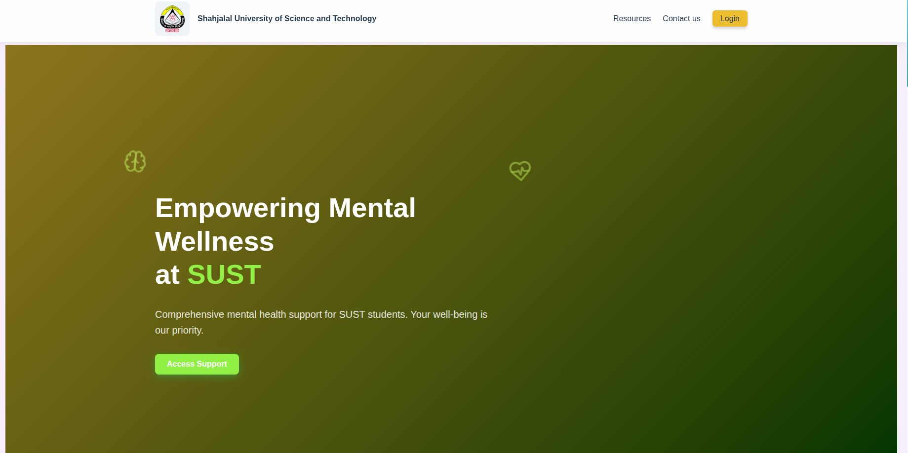
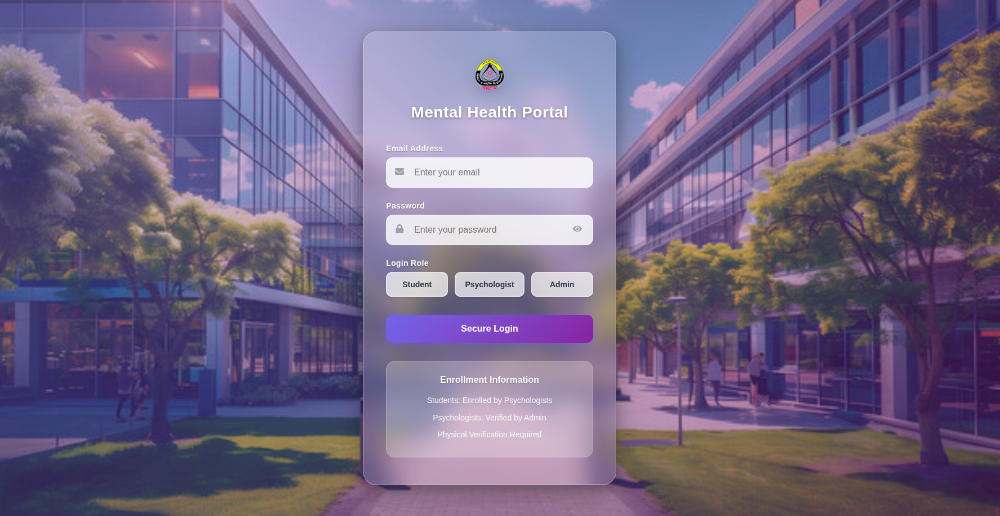

# SUST Mental Health Portal

🌐 **Live demo:** https://sust-mental-health.vercel.app
<p float="left">
  
  
</p>

> The backend runs on a free hosting plan and sleeps when idle, so the first load can take up to ~50 seconds.

A platform for students at Shahjalal University of Science and Technology (SUST) to connect with university-assigned psychologists, track session history, and get AI-assisted emotional support.

## User Roles

**Admin**
- Registers and manages psychologists assigned by the university
- Oversees the system

**Psychologist**
- Views upcoming sessions in a calendar
- Adds and manages student profiles, records session notes and logs
- Schedules sessions with conflict checking
- Creates and manages mental health seminars

**Student**
- Views past and upcoming sessions
- Chats with **MindMate**, an AI chatbot personalized with an AI-generated summary
- Sees tailored motivational quotes
- Plays 3D relaxation games

## AI Features
- **MindMate chatbot:** context-aware emotional support (not medical advice)
- **AI summaries:** generated from past interactions and logs
- **Motivational quotes:** based on the student's summary

## Tech Stack
- **Frontend:** React (Create React App), Socket.io client
- **Backend:** Node.js, Express.js, Socket.io
- **Database:** MongoDB (Atlas)
- **Auth:** JWT
- **AI:** Groq API with `llama-3.3-70b-versatile`
- **Other:** Cloudinary (images), Nodemailer (email)
- **Hosting:** Vercel (frontend), Render (backend)

## Run Locally

```bash
git clone https://github.com/manisa2020331058/SUST_MENTAL_HEALTH.git
cd SUST_MENTAL_HEALTH
```

**Backend**
```bash
cd Backend
npm install
cp .env.example .env   # then fill in your own values
npm start
```

**Frontend** (in a second terminal)
```bash
cd frontend
npm install --legacy-peer-deps
npm start
```
Open http://localhost:3000

**Environment variables** (`Backend/.env`): `MONGO_URI`, `JWT_SECRET`, `JWT_EXPIRE`, `GROQ_API_KEY`, `EMAIL_HOST`, `EMAIL_PORT`, `EMAIL_USER`, `EMAIL_PASSWORD`, `CLOUDINARY_CLOUD_NAME`, `CLOUDINARY_API_KEY`, `CLOUDINARY_API_SECRET`

Create the first admin with `node seedAdmin.js` in the `Backend` folder.

## Notes
- Do not use real student data in the demo deployment.
- Email features require an SMTP-capable host or an email API.